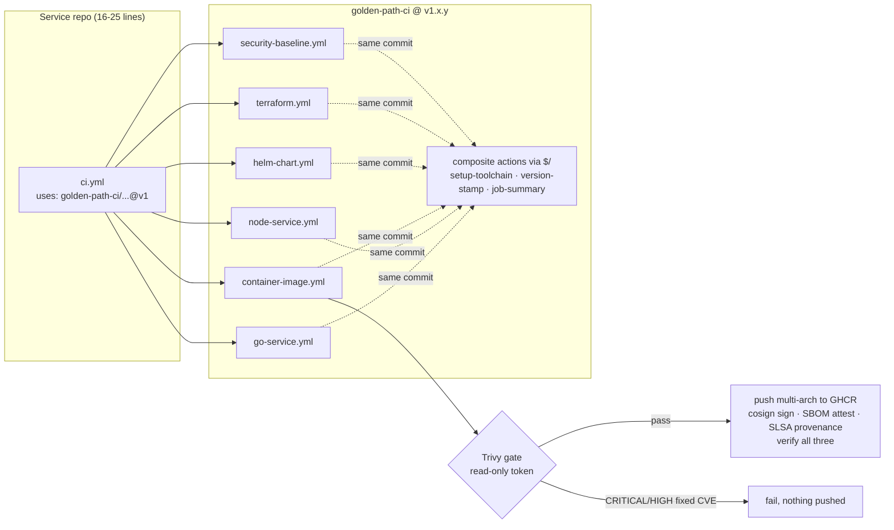

# golden-path-ci

[](https://github.com/ahmedelgmal310/golden-path-ci/actions/workflows/self-test.yml)
[](https://github.com/ahmedelgmal310/golden-path-ci/actions/workflows/release.yml)
[](LICENSE)

A versioned library of **reusable GitHub Actions workflows** and **composite actions**
that a platform team hands to every service repository. A Go service, a TypeScript
service, a Helm chart and a Terraform module each adopt the full pipeline (tests,
linters, security scans, signed and attested images) with **16 to 25 lines of YAML**.
The 290 to 720 lines behind those calls are maintained once, here.

Every claim below is re-proven on each push to `main`. The library runs its own
workflows against sample projects in [`examples/`](examples). A meta-test also runs
them against **negative fixtures** (a leaked key, a base image with a critical CVE, an
unformatted Terraform file) and fails CI unless each gate fails **at the right step
and for the right reason**.

## Contents

- [The problem](#the-problem)
- [How it works](#how-it-works)
- [What a consumer writes](#what-a-consumer-writes)
- [The workflows](#the-workflows)
- [Composite actions](#composite-actions)
- [Proving the gates: self-test and meta-test](#proving-the-gates-self-test-and-meta-test)
- [Results from CI](#results-from-ci)
- [Policy: pins and permissions](#policy-pins-and-permissions)
- [Versioning and releases](#versioning-and-releases)
- [Limitations](#limitations)
- [Runbook](#runbook)
- [Repository layout](#repository-layout)

## The problem

When every repository writes its own CI, the same 200+ lines are copy-pasted and then
drift. One team pins actions by SHA and another uses `@main`. One scans images and
another doesn't. Some grant `write-all` to a job that runs `npm install`. A fix to
the shared pattern, such as a new Trivy flag or a cosign identity change, means
pull requests to dozens of repositories, and nobody can say which ones still run
the old version.

A golden path fixes this by making the secure pipeline the easy default:

- **One place to change.** A fix ships as a `v1.x.y` release and reaches every repository on `@v1`, or arrives as one Dependabot PR for repositories that pin a SHA.
- **Secure by default.** Least-privilege tokens, SHA-pinned actions, digest-pinned scanners, gates that fail closed.
- **Proven, not promised.** The library's CI fails if a gate stops catching what it is meant to catch.

## How it works



The reusable workflows call their composite actions with GitHub's
[self-repository syntax](https://github.blog/changelog/2026-07-30-reference-same-repository-actions-with-self-repository-syntax)
(`uses: $/actions/setup-toolchain`). It resolves to the **same commit as the
workflow file**, with no second checkout. A consumer who pins
`go-service.yml@<sha>` therefore runs exactly that commit's actions as well. A
floating `@v1` reference inside the library would quietly defeat the pin.

## What a consumer writes

This is the complete CI for the Go example
([`examples/go-service/.github/workflows/ci.yml`](examples/go-service/.github/workflows/ci.yml)).
It covers tests with a coverage gate, golangci-lint, govulncheck, a multi-arch image
that is scanned, signed, SBOM-attested and given SLSA provenance, Gitleaks, dependency
review and CodeQL:

```yaml
name: ci
on:
  push:
    branches: [main]
  pull_request:
permissions:
  contents: read
concurrency:
  group: ci-${{ github.ref }}
  cancel-in-progress: true
jobs:
  go:
    uses: ahmedelgmal310/golden-path-ci/.github/workflows/go-service.yml@v1
  image:
    needs: go
    uses: ahmedelgmal310/golden-path-ci/.github/workflows/container-image.yml@v1
    permissions: { contents: read, packages: write, id-token: write, attestations: write }
    with:
      image-name: ghcr.io/acme/go-service
      push: ${{ github.event_name == 'push' }}
  security:
    uses: ahmedelgmal310/golden-path-ci/.github/workflows/security-baseline.yml@v1
    permissions: { contents: read, security-events: write, actions: read }
    with:
      codeql-languages: '["actions","go"]'
```

For byte-for-byte reproducible CI, pin a SHA instead of `@v1` and let Dependabot
bump it (`uses: ...go-service.yml@<sha> # v1.0.0`). The trade-offs and the upgrade
path are in [docs/consumer-guide.md](docs/consumer-guide.md).

## The workflows

Every input has a default. Only `container-image.yml` has a required input (`image-name`).

| Workflow | Gates, in order | Key inputs (defaults) | Caller grants |
|---|---|---|---|
| [`go-service.yml`](.github/workflows/go-service.yml) | `go mod verify` → `go vet` → golangci-lint → `go test -race` + coverage gate → govulncheck → `go build` | `go-version` 1.27.3, `coverage-threshold` 70, `race` true, `golangci-lint-version` v2.14.0 | `contents: read` |
| [`node-service.yml`](.github/workflows/node-service.yml) | `npm ci --ignore-scripts` → `npm audit` → lint → type check → test → build | `node-version` 24.22.0, `audit-level` high, script names | `contents: read` |
| [`container-image.yml`](.github/workflows/container-image.yml) | **build-scan** (read-only token): hadolint → amd64 build → Trivy gate. **publish** (only if `push`): multi-arch push → cosign keyless sign → CycloneDX SBOM attestation → SLSA provenance → verify | `platforms` linux/amd64,linux/arm64, `severity` CRITICAL,HIGH, `ignore-unfixed` true | `contents: read`, `packages: write`, `id-token: write`, `attestations: write` |
| [`helm-chart.yml`](.github/workflows/helm-chart.yml) | `helm lint --strict` (defaults + each values file) → helm-unittest → `helm template` piped to `kubeconform -strict` | `helm-version` v4.3.0, `kubernetes-version` 1.34.0, `values-files` | `contents: read` |
| [`terraform.yml`](.github/workflows/terraform.yml) | `fmt -check` → `init -backend=false -lockfile=readonly` → `validate` → tflint → Checkov | `terraform-version` 1.16.5, `tflint-version` v0.64.0 | `contents: read` |
| [`security-baseline.yml`](.github/workflows/security-baseline.yml) | Gitleaks over the full history (or one directory) → dependency review (PRs) → CodeQL matrix | `gitleaks-mode` git, `codeql-languages` `["actions"]` | `contents: read`, `security-events: write`, `actions: read` |

Common to all of them:

- **Least privilege.** Every workflow defaults to `contents: read`. Write scopes are granted per job, only where needed, with a comment saying why. Image `RUN` steps execute in a job whose token cannot push packages or mint an OIDC token.
- **Pinned everything.** Actions by full SHA, scanner images by digest (`trivy`, `gitleaks`, `checkov`, `hadolint`), downloaded binaries (kubeconform, tflint) by SHA-256.
- **Caching with one key scheme.** `gp-<tool>-<cache-version>-<os>-<version>-<lockfile hash>`: Go modules + build + lint caches, npm cache, Terraform provider cache, tflint plugins, kubeconform schemas, helm plugins, the Trivy DB, and BuildKit layers in the GitHub Actions cache. Bump `cache-version` to invalidate.
- **Job summaries instead of PR comments.** Each job ends with the same results table (check, pass/FAIL, detail), so no job needs `pull-requests: write`.
- **Timeouts and concurrency.** Every job has `timeout-minutes`. The publish job serialises per image and ref, and consumer callers cancel superseded PR runs.

## Composite actions

| Action | Purpose |
|---|---|
| [`actions/setup-toolchain`](actions/setup-toolchain/action.yml) | Installs an exact Go or Node.js version and restores dependency, build and lint caches. Output: `cache-hit` |
| [`actions/version-stamp`](actions/version-stamp/action.yml) | One identity per commit: `version` (`X.Y.Z` on a tag, else `0.0.0-<branch>.<sha>`), `short-sha`, a reproducible `build-date` (commit time), `image-tags` |
| [`actions/job-summary`](actions/job-summary/action.yml) | Renders `name\|outcome\|detail` lines as the uniform summary table |

Consumers can use them directly too:
`uses: ahmedelgmal310/golden-path-ci/actions/version-stamp@<sha> # v1.0.0`.

## Proving the gates: self-test and meta-test

[`self-test.yml`](.github/workflows/self-test.yml) treats this repository as its own
first consumer:

| Job | What it proves |
|---|---|
| `go-service`, `node-service`, `helm-chart`, `terraform` | Each workflow passes a well-behaved example ([`examples/`](examples)) |
| `container-image` | On `main` it builds and pushes `ghcr.io/ahmedelgmal310/golden-path-ci/example-go-service` for amd64 + arm64, signs it, attests the SBOM and provenance, and **verifies** all three before going green |
| `security-baseline` | Gitleaks over the full history (the negative fixture is allowlisted by path in [`.gitleaks.toml`](.gitleaks.toml)), plus CodeQL for Actions, Go and TypeScript |
| `policy` | Pin and permission policy, actionlint, zizmor ([below](#policy-pins-and-permissions)) |
| `yaml-budget` | Counts consumer lines against reused library lines ([`scripts/yaml-budget.sh`](scripts/yaml-budget.sh)) |
| `meta-test` | **Negative fixtures fail for the right reason** (next table) |

The meta-test ([`scripts/meta-test.sh`](scripts/meta-test.sh)) dispatches
[`negative-fixtures.yml`](.github/workflows/negative-fixtures.yml), which runs the
**real** reusable workflows on [`examples/negative/`](examples/negative). It then
reads that run's jobs and logs through the API and asserts each failure:

| Fixture | Workflow | Must fail at step | Evidence required in the log |
|---|---|---|---|
| `leaked-secret/deploy-key.pem`, a private-key-shaped text file (not key material) | `security-baseline.yml`, `gitleaks-mode: dir` | `Gitleaks` | `RuleID: private-key`, `leaks found: 1` |
| `critical-cve-image/Dockerfile`, `FROM alpine:3.14.0` | `container-image.yml`, `push: false` | `Trivy vulnerability gate` | `CVE-2021-36159` (apk-tools, CRITICAL) |
| `unformatted-terraform/main.tf` | `terraform.yml` | `terraform fmt` | `main.tf` |

Each assertion also requires that **every earlier step passed**, so a broken
checkout cannot pass as the right failure. It also requires that **no other job
failed** and that the vulnerable image's **publish job was skipped**.

A failing reusable-workflow call always turns a run red, and GitHub has no
`continue-on-error` for `uses:` jobs. So the meta-test creates a throwaway commit
with the **same tree** as the commit under test on a `meta-test/<run>` branch,
dispatches the negative run there, and deletes the branch afterwards. The red run
is visible in the Actions tab ("expected to fail") and never touches `main`'s
commit status.

## Results from CI

All numbers on this page come from these runs (GitHub-hosted `ubuntu-24.04`, 2026-10-28):

- **Green self-test on `main`**: [run 40726928822](https://github.com/ahmedelgmal310/golden-path-ci/actions/runs/40726928822). All 15 jobs passed, including the meta-test. Wall time 2m 53s.
- **Negative run the meta-test asserted on**: [run 40727032498](https://github.com/ahmedelgmal310/golden-path-ci/actions/runs/40727032498) (red by design).
- **Cache benchmark**: [cold run 40730590394](https://github.com/ahmedelgmal310/golden-path-ci/actions/runs/40730590394) and [warm run 40730826414](https://github.com/ahmedelgmal310/golden-path-ci/actions/runs/40730826414), both with `cache-version: bench-20261028a`.

### Lines of YAML a consumer writes

From the `Consumer YAML budget` job ([`scripts/yaml-budget.sh`](scripts/yaml-budget.sh)). The script counts non-blank, non-comment lines of the consumer file and of every library file it pulls in.

| Consumer | Lines the team writes | Library YAML it reuses |
|---|---:|---:|
| Go service: tests, lint, vulns, signed multi-arch image, security baseline | **25** | 716 |
| TypeScript service: npm audit, type check, tests, build, security baseline | **18** | 340 |
| Helm chart: lint, unittest, kubeconform, security baseline | **19** | 302 |
| Terraform module: fmt, validate, tflint, Checkov, security baseline | **16** | 291 |
| **Total** | **78** | **1,649** |

Roughly **20 lines instead of 290 to 720** per repository. The library lines are maintained, tested and versioned in one place.

### Pipeline duration, cold vs warm cache

From [`scripts/bench-report.sh`](scripts/bench-report.sh) (job `started_at` to `completed_at`, one sample each):

| Job | Cold cache | Warm cache | Saved |
|---|---:|---:|---:|
| `go-service / Go checks` | 1m 02s | 0m 22s | 64% |
| `container-image / Build and scan` | 0m 59s | 0m 37s | 37% |
| `helm-chart / Helm checks` | 0m 12s | 0m 08s | 33% |
| `terraform / Terraform checks` | 0m 37s | 0m 31s | 16% |
| `node-service / Node checks` | 0m 14s | 0m 18s | -28% |

How to read it:

- **Go gains the most.** The module, build and golangci-lint caches skip compiling the toolchain's standard library and re-running the linters on unchanged packages.
- **The image build** reuses BuildKit layers from the GitHub Actions cache and a Trivy DB that is restored instead of downloaded.
- **Terraform** restores the AWS provider (about 150 MB) from cache, but most of its time goes to pulling the Checkov image, which is not cached.
- **Node got slower.** The example has two dev dependencies, so restoring the npm cache costs more than `npm ci` saves. With one sample per job this is within run-to-run noise. A dependency-heavy service would show the opposite. The number is reported as measured.

### Supply chain on the published image

The green run pushed `ghcr.io/ahmedelgmal310/golden-path-ci/example-go-service@sha256:6b1c63162a8a4362c31b725d642c1ad05b3922545eb9b3b53c78c10eeb5a263f`
(linux/amd64 + linux/arm64). The publish job then verified in CI:

- cosign signature for identity `https://github.com/ahmedelgmal310/golden-path-ci/.github/workflows/container-image.yml@refs/heads/main`
- CycloneDX SBOM attestation (`cosign verify-attestation --type cyclonedx`)
- SLSA build provenance (`gh attestation verify --signer-workflow ahmedelgmal310/golden-path-ci/.github/workflows/container-image.yml`)

### Gates in the green run

| Gate | Result |
|---|---|
| Go coverage | 75.5% (gate 70%), race detector on, govulncheck clean |
| TypeScript coverage | 97.6% lines (gate 80%), `npm audit` 0 vulnerabilities |
| Trivy on the Go image (CRITICAL/HIGH, fixed) | 0 findings |
| Checkov on the Terraform module | 39 passed, 0 failed, 3 skipped (inline key-policy skips with reasons). 2 checks are excluded in `.checkov.yaml` with reasons |
| Gitleaks over the full history | 0 findings (one fixture path allowlisted) |
| workflow-policy, actionlint, zizmor | 0 findings on 13 workflow and action files |
| Meta-test | 3 of 3 negative fixtures failed at the expected step with the expected evidence. The vulnerable image's publish job was skipped |

## Policy: pins and permissions

[`tools/workflow-policy`](tools/workflow-policy) is a small Go linter (`gopkg.in/yaml.v3`,
line-accurate findings, unit-tested against [good and bad fixtures](tools/workflow-policy/testdata)).
It enforces the house rules on every workflow and composite action:

| Rule | Fails when |
|---|---|
| GP001 | a remote `uses:` is not pinned to a 40-character SHA, or a `docker://` image has no digest. `./` and `$/` (same commit) are allowed |
| GP002 | a pinned SHA has no `# vX.Y.Z` comment (reviewers and Dependabot need it) |
| GP003 | a job has no `permissions` and the workflow sets no default |
| GP004 | `permissions: write-all` or `read-all` |
| GP005 | a job has no `timeout-minutes` (the default is 6 hours) |
| GP006 | the trigger is `pull_request_target` or `workflow_run` |
| GP007 | `actions/checkout` does not set `persist-credentials: false` |

CI runs it next to **actionlint** (syntax, expressions, shellcheck) and **zizmor**
(template injection, excessive permissions, cache poisoning and more). Two narrow
actionlint ignores and one zizmor rule exception are documented in
[`.github/actionlint.yaml`](.github/actionlint.yaml) and [`.github/zizmor.yml`](.github/zizmor.yml).
Both exist because actionlint 1.7.12 predates the `$/` syntax and the `job.workflow_*` context.

```sh
cd tools/workflow-policy && go test ./... && go run . ../../.github/workflows ../../actions
```

## Versioning and releases

- Immutable release tags `vX.Y.Z`, plus a floating major tag `v1` that always points at the latest `v1.x.y`.
- [`CHANGELOG.md`](CHANGELOG.md) follows Keep a Changelog. The [consumer guide](docs/consumer-guide.md) defines what counts as breaking. Stricter gate defaults count as a **major** change, because they fail builds that used to pass.
- [`release.yml`](.github/workflows/release.yml) runs when a `vX.Y.Z` tag is pushed. It verifies that the tag is on `main`, that **self-test passed for that exact commit**, and that the CHANGELOG has the section. It then publishes the GitHub Release with that section as notes and moves `vX` to the release.
- Every tool and action version is at least 14 days old when adopted, with one documented security exception (Go 1.27.3). See [docs/versions.md](docs/versions.md). Dependabot applies the same 14-day cooldown.

## Limitations

- **The negative run is red by design.** The `negative-fixtures` workflow shows failed runs in the Actions tab. That is the point, but it reads as noise until you know why. The meta-test also needs `contents: write` to create the throwaway branch, so it is skipped for fork and Dependabot PRs.
- **Trivy scans the amd64 image only.** The gate scans the image that was built and loaded on the runner. The arm64 variant is pushed without its own scan. OS packages almost always match across architectures, but this is not proven.
- **Dependency review needs the repository's dependency graph.** On this repository the dependency graph is off, so `Dependency review` fails on pull requests with "Dependency review is not supported on this repository". It is skipped on `main` pushes and does not affect the green runs linked above. A consumer must have the dependency graph enabled.
- **CodeQL compiled languages use autobuild.** Go works. Java, C# and C/C++ projects with non-standard builds need a manual build step, which this workflow does not offer yet.
- **Consumer examples are documentation, not executed files.** `examples/*/.github/workflows/ci.yml` show what a team commits. Self-test runs the same workflows with the same inputs from the local checkout, but nothing checks that the two stay identical.
- **The Terraform lock file covers `linux_amd64` only.** That is enough for CI. Developers on other platforms run `terraform providers lock -platform=<os_arch>` once.
- **Kubernetes schemas stop at 1.34.** kubeconform's default schema catalogue (yannh/kubernetes-json-schema) has nothing newer yet. Override `kubernetes-version` if your cluster is older.
- **GitHub.com only.** The `$/` syntax and `job.workflow_*` context are not available on GitHub Enterprise Server.

## Runbook

| Situation | Action |
|---|---|
| A consumer build fails at a gate | Open the job summary. The failing row names the gate, and the step log has the finding (CVE ID, Gitleaks rule and file, `terraform fmt -diff`). Fix the code, or document an exception in the consumer repo (`.checkov.yaml`, `.gitleaks.toml`, `.trivyignore`). Do not lower library defaults for one repository. |
| A gate is broken for everyone (scanner outage, bad tool release) | Revert in this repo, cut a patch release, and `v1` moves automatically. SHA-pinned consumers roll back by keeping their current SHA. |
| Cache is corrupted or poisoned | Callers pass a new `cache-version` (for example `v2`). Old entries age out. Nothing needs to be deleted. |
| Releasing | Add a `## [X.Y.Z]` section to `CHANGELOG.md` on `main`, wait for self-test to go green, then `git tag vX.Y.Z <sha> && git push origin vX.Y.Z`. `release.yml` does the rest. |
| Release workflow refuses | It prints why: the tag is not on `main`, no green self-test for the commit, or no CHANGELOG section. Fix that, then delete and re-push the tag. |
| Bumping a tool or action | Wait out the 14-day cooldown (or document a security exception). Update the SHA and comment and `docs/versions.md` in the same PR. Self-test plus meta-test must stay green. |
| Meta-test fails | Read its summary table. It names the fixture, the step it expected, and what actually happened (wrong step, missing evidence, or an unexpected pass). An unexpected pass means a gate stopped working. Treat it as a security bug. |
| Verifying a published image | `cosign verify <image>@<digest> --certificate-identity https://github.com/ahmedelgmal310/golden-path-ci/.github/workflows/container-image.yml@refs/heads/main --certificate-oidc-issuer https://token.actions.githubusercontent.com` and `gh attestation verify oci://<image>@<digest> --repo <consumer-repo>` |
| Measuring cache impact | Dispatch `benchmark.yml` with a new `cache-version` (cold), then again with the same value (warm). Run `scripts/bench-report.sh <cold-run> <warm-run>`. |

## Repository layout

```
.github/workflows/   reusable workflows (go-service, node-service, container-image,
                     helm-chart, terraform, security-baseline) and this repo's own CI
                     (self-test, negative-fixtures, benchmark, release)
actions/             composite actions: setup-toolchain, version-stamp, job-summary
examples/            sample consumers: go-service, ts-service, helm-chart, terraform-module
examples/negative/   fixtures that must fail: leaked-secret, critical-cve-image, unformatted-terraform
tools/workflow-policy/  pin and permission linter (Go)
scripts/             meta-test.sh, yaml-budget.sh, bench-report.sh
docs/                versions.md (every pin and why), consumer-guide.md (adopt and upgrade)
```

## License

[MIT](LICENSE)
